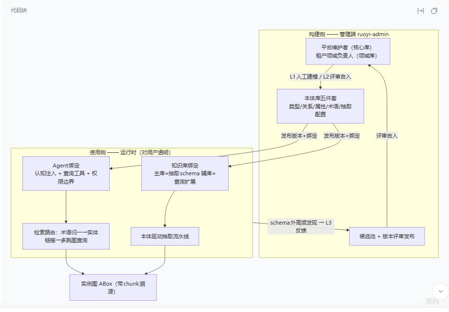
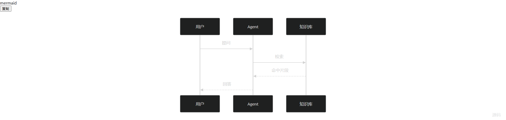
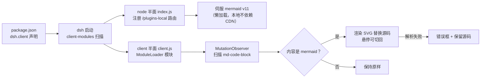

# dsh-mermaid-boost

[](https://www.npmjs.com/package/dsh-mermaid-boost)
[](https://www.npmjs.com/package/dsh-mermaid-boost)
[](LICENSE)

[DeepSeek Harness（dsh）](https://github.com/deepseek-ai/deepseek-harness) Web GUI 的
Mermaid 渲染插件：把对话消息、Markdown 文档预览、交付物卡片里所有 ` ```mermaid `
代码块直接渲染成图，不再只是干巴巴的源码。



## 特性

- **全渲染面覆盖**：对话 / 文档预览 / 交付物卡片共用同一套 `MarkdownText` 组件，一处扫描全部生效
- **自包含**：内置 mermaid v11 库，由插件自身路由伺服（`/plugins-local/mermaid-boost/`），不依赖 CDN、离线可用
- **内容识别**：对话 banner 不暴露围栏语言，按首行图类型识别；文档预览优先读 banner 的 `mermaid` infostring
- **流式友好**：1.2s 防抖，文本稳定后才渲染；解析错误静默重试，稳定 2.5s 后才显示错误
- **优雅降级**：渲染失败显示错误框并保留源码；非 mermaid 代码块完全不受影响
- **跟随主题**：按代码块背景亮度自动选择 mermaid `default` / `dark` 主题
- **React 安全**：只追加自有节点与切换 display，不触碰 React 管理的 DOM

悬停渲染好的图表，右下角出现"源码 / 图表"切换按钮：



## 工作原理



dsh 的客户端插件机制：npm 包在 `package.json` 里声明
`dsh.client: { platform: "web", immediately: true }` 并导出 `./client` bundle，
cordis 组合里的对应 entry 会让 dsh 在浏览器端加载它（`window.__ModuleLoader__` 惰性 CJS 模块表）。

## 安装

### 方式一：npm 安装（推荐，跨平台）

前提：node ≥ 18、dsh 已初始化过对应 profile（跑过一次 `dsh web`）。

```bash
dsh plugin --profile web add dsh-mermaid-boost
node node_modules/dsh-mermaid-boost/scripts/install.mjs --profile web
```

第二条命令把 loader entry 写进 profile 的 `cordis.patch.yml`（幂等，自动备份）。
然后**重启 dsh web**，刷新 GUI 即可。

macOS / Linux 同理，只是路径与前缀不同（`~/.dsh/profiles/web/...`）。

### 方式二：源码安装（Windows / PowerShell）

```powershell
git clone https://github.com/icnws/dsh-mermaid-boost.git
cd dsh-mermaid-boost
pwsh -File install.ps1                  # 默认安装到 web profile
# pwsh -File install.ps1 -ProfileName 其他profile名
```

`install.ps1` 幂等可重复执行，它自动完成：

1. 复制插件包到 `<profile>\plugins\mermaid-boost\`
2. 运行 `scripts/prepare-mermaid.mjs` 生成 mermaid 库（首次需联网下载 mermaid@11）
3. `pnpm-workspace.yaml` 加 `plugins/*`
4. profile `package.json` 加 `"dsh-mermaid-boost": "workspace:*"`
5. `cordis.patch.yml` 追加 `- insert: [{id: mermaid-boost, name: dsh-mermaid-boost}]`
6. 建 `node_modules\dsh-mermaid-boost` junction（官方等价命令：`dsh plugin install --profile web`）

所有配置改动前自动留 `.bak-mermaid-boost` 备份。

最后**重启 dsh web**（关掉重跑 `dsh web`），刷新 GUI 即可。

## 手动安装

不想跑脚本的话，按上面 1–6 步手工操作即可，要点：

- 插件包的 `package.json` 必须有 `dsh.client` 声明和 `exports["./client"]`
- `lib/mermaid` 必须存在（`node scripts/prepare-mermaid.mjs` 生成；mermaid 的
  `.mjs` 会被改名 `.js` 并重写内部引用——dsh 静态服务器没有 `.mjs` 的 MIME 映射）
- `cordis.patch.yml` 里用 `- insert:` 追加 loader entry
- 改完重启 dsh web

## 卸载

1. 删除 profile `cordis.patch.yml` 里那段 `mermaid-boost` 的 insert
2. 删除 profile `package.json` 里 `"dsh-mermaid-boost": "workspace:*"`
3. （可选）删除 `plugins\mermaid-boost\` 目录和 `node_modules\dsh-mermaid-boost` 链接
4. 重启 dsh web

## 开发

- 改 `lib/client.js`（浏览器端逻辑）后重启 dsh web 生效
- 改 `lib/index.js`（路由）后重启 dsh web 生效（node 代码不热重载）
- 升级 mermaid：删除 `lib/mermaid/` 目录，重跑 `npm run prepare:mermaid`

### 发布 npm 包

`lib/mermaid/` 不进 git，但通过 package.json 的 `files` 字段进 npm 包，所以
发布前先确保 vendor 树存在：

```bash
npm run prepare:mermaid     # 已存在则跳过；删除 lib/mermaid 可强制重生成
npm login                   # 首次发布需要
npm publish
```

之后别人就能用上面的"方式一"安装。升级流程：改代码 → `npm version patch` →
重跑 prepare（如 mermaid 有升级）→ `npm publish` → 提交推送 git。

### 排错

| 症状 | 原因 |
|---|---|
| GUI 白屏 "Failed to load plugins ... apply method" | 某个 client 模块 materialize 成 undefined：检查插件的 `lib/client.js` 是否 `return module.exports` |
| 启动日志 "1 entry did not activate ... failed to import" | node 半面 import 报错，看 stderr 异常行 |
| 库路由 404 | node 半面没挂载（webServer inject 失败 / entry 未激活） |
| 代码块不渲染 | 打开控制台看 `[mermaid-boost]` 警告；确认块首行是 mermaid 图类型 |

## License

[MIT](LICENSE) — mermaid 库同样以 MIT 发布。
